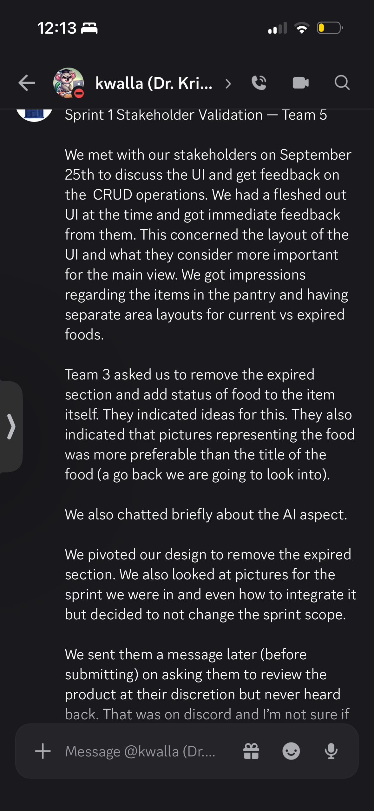
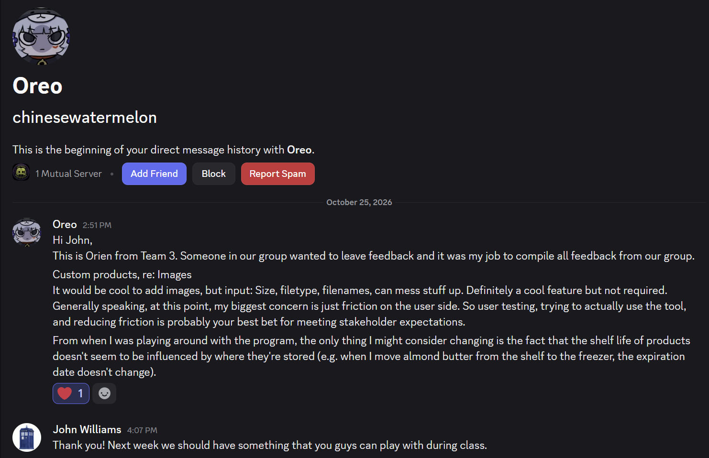

# 10/11/2026:

print 1 Stakeholder Validation — Team 5

We met with our stakeholders on September 25th to discuss the UI and get feedback on the  CRUD operations. We had a fleshed out UI at the time and got immediate feedback from them. This concerned the layout of the UI and what they consider more important for the main view. We got impressions regarding the items in the pantry and having separate area layouts for current vs expired foods. 

Team 3 asked us to remove the expired section and add status of food to the item itself. They indicated ideas for this. They also indicated that pictures representing the food was more preferable than the title of the food (a go back we are going to look into). 

We also chatted briefly about the AI aspect. 

We pivoted our design to remove the expired section. We also looked at pictures for the sprint we were in and even how to integrate it but decided to not change the sprint scope. 

We sent them a message later (before submitting) on asking them to review the product at their discretion but never heard back. That was on discord and I’m not sure if inner team communication is working. That was in the project showcase channel.

# 10/23/2026:

We sat down with the coustomer and reviewed the product. THey had good feedback and were impressed by the drag and n drop as well as the overall performance. Their comments centered around: 
* making adding an item a drag feature (something we suggested)
* for globsal pantry, the photos are good to go
* for adding custom food, either use a ? pic, or just not allow images at all

